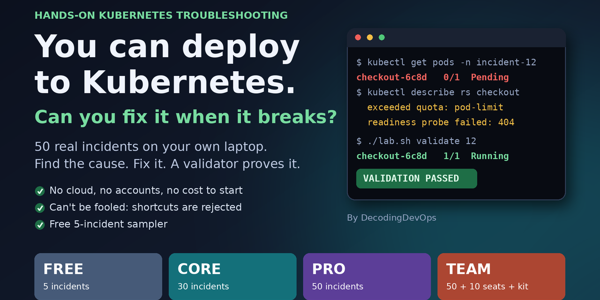

# Kubernetes Incident Lab: hands-on Kubernetes troubleshooting practice

**Break a real cluster, find the cause, fix it, and let a validator prove you did.** This free sample gives you two Kubernetes troubleshooting incidents that run on a local [kind](https://kind.sigs.k8s.io/) cluster on your own laptop. No cloud account, no cost, no video to sit through.



```text
$ ./lab.sh start 1
Incident 1 started: The Workload Won't Start
$ kubectl get pods -n incident-01
report-api-6c8d9   0/1   CreateContainerConfigError
...you investigate and fix it...
$ ./lab.sh validate 1
VALIDATION PASSED
```

## Why practise this way
- **Realistic.** Each incident is a believable production ticket with a real cause, not a quiz.
- **Can't be fooled.** The validator checks the actual cluster state and rejects shortcuts such as deleting the workload.
- **Safe.** The lab uses its own kubeconfig, so it can only reach the lab cluster, never your real ones.
- **Local and offline.** After the first setup the images live inside the cluster.

## The two incidents in this sample
| No. | Incident | Area | Level |
| --- | --- | --- | --- |
| 01 | [The Workload Won't Start](labs/01-workload-wont-start/scenario.md) | Workloads | 1 / 5 |
| 02 | [The Service Is Unreachable](labs/02-service-unreachable/scenario.md) | Networking | 2 / 5 |

## Quick start
You need Docker, kubectl and kind. On Windows use WSL2 ([setup guide](docs/windows-setup.md)).

```bash
./lab.sh doctor     # checks your machine
./lab.sh setup      # creates the local cluster, 2 to 4 minutes, once
./lab.sh start 1    # break something
./lab.sh shell      # a shell whose kubectl only reaches the lab
./lab.sh validate 1 # objective check that you really fixed it
./lab.sh reset 1    # clean up
```

| Tool | macOS | Windows | Linux |
| --- | --- | --- | --- |
| Docker | `brew install --cask docker` | [WSL2 guide](docs/windows-setup.md) | [Docker Engine](https://docs.docker.com/engine/install/) |
| kubectl | `brew install kubectl` | [WSL2 guide](docs/windows-setup.md) | [kubectl install guide](https://kubernetes.io/docs/tasks/tools/) |
| kind | `brew install kind` | [WSL2 guide](docs/windows-setup.md) | [kind install guide](https://kind.sigs.k8s.io/docs/user/quick-start/#installation) |

Give Docker about 4 GB of memory (6 GB is better). `./lab.sh doctor` tells you what is missing.

## How an incident works
1. Read the short ticket (`scenario.md`) and write down your first theory.
2. Investigate with `kubectl`: events, describe, logs, endpoints.
3. Fix it. Hints are free (`./lab.sh hint 1 1`), from gentle to specific.
4. Run `./lab.sh validate 1`. It passes only when the real problem is fixed.

## Want more?
This repository is a free sample. The full lab has **50 incidents** across workloads, networking, storage, RBAC, scheduling, rollouts and security, with full walkthroughs, learning paths, post-mortem templates and a team game-day kit.

**[See the editions](https://decodedevops.gumroad.com/l/k8slab)**

## FAQ
**How do I practise Kubernetes troubleshooting without a cloud account?**
Run the lab: it creates a three-node cluster inside Docker on your computer with kind.

**Is it useful for CKA and CKAD preparation?**
Troubleshooting is a large part of the CKA exam, and these incidents exercise the same `kubectl` investigation skills. It is practice material, not official exam content.

**Which versions does it use?**
It was tested with kind v0.18.0 (Kubernetes v1.34.x), Docker and kubectl. Newer kind versions normally work but start a newer Kubernetes that has not been tested.

**Something doesn't work. Where do I ask?**
Open an issue and include the output of `./lab.sh doctor`.

## Licence and trademarks
Free to use for your own learning. See [LICENSE.md](LICENSE.md) for what you may share. Kubernetes is a registered trademark of The Linux Foundation. This project is not affiliated with or endorsed by the Linux Foundation or the CNCF.
